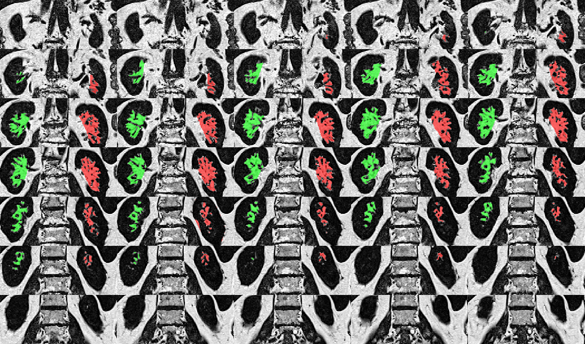
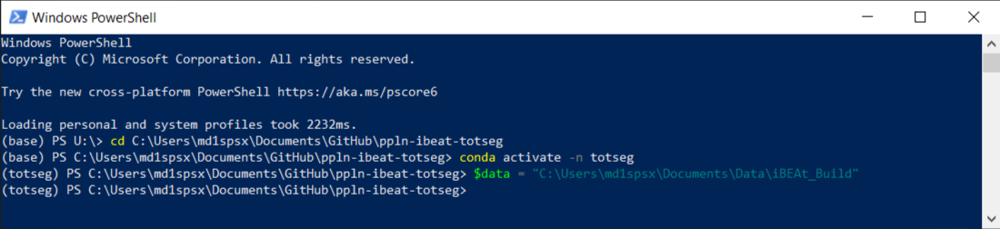
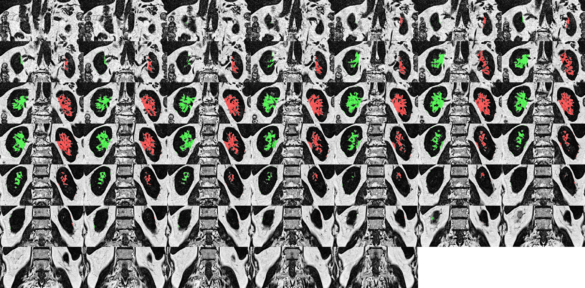
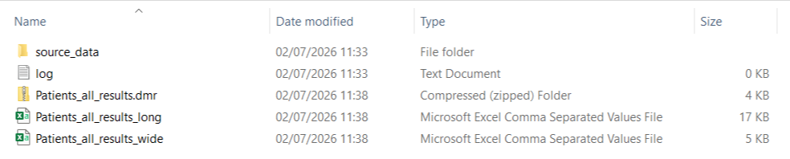
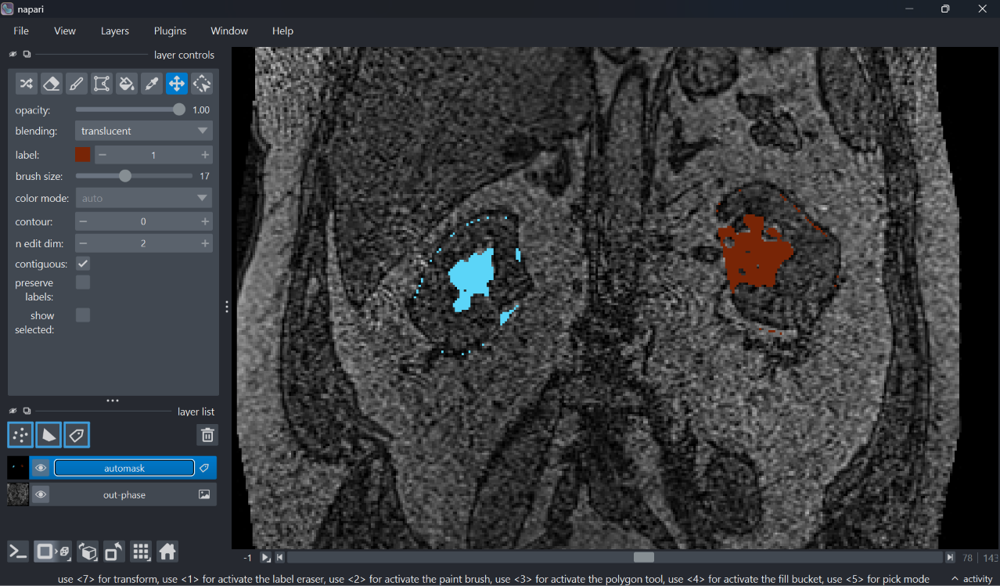
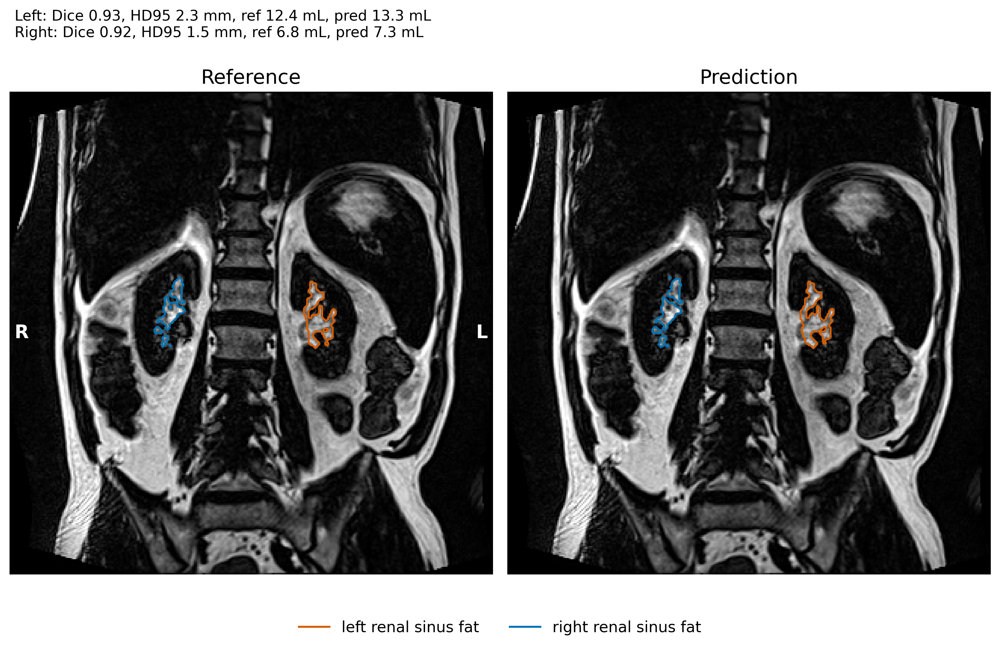
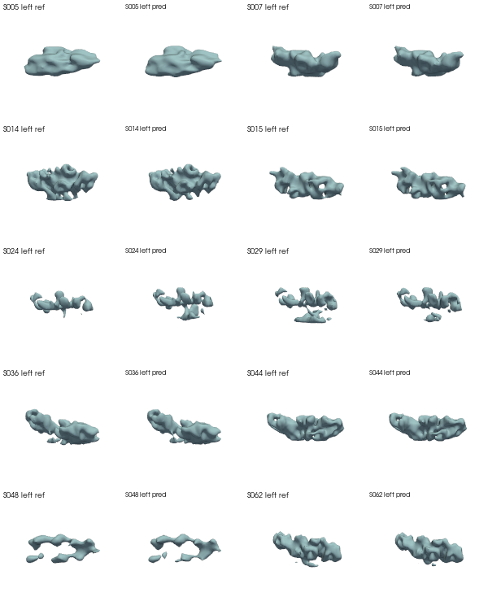

---
## Semi-automated and nnU-Net segmentation of RSF masks

---




## 🚀 Purpose

This pipeline trains and validates a deep-learning model (nnUNET) to segment renal sinus fat on 4-channel Dixon. The model is trained using 703 datasets from 549 participants of the iBEAt study on diabetic kidney disease. The data themselves are currently embargoed until the completion of the study. 

The final model can be deployed via the python package [miblab-dl](https://openmiblab.github.io/docs-miblab-dl/).

## 🛠️ Requirements

What you need to run the scripts in this pipeline:

- Python installation
- Miniconda installation
- Download of this repository

Conda is the software that creates python environments, but you will need to initialise it before you can use it. Miniconda comes with a simple app to help you with this. Search for *Anaconda Prompt* among your apps, open it, and type: 

```bash
conda init powershell
```

You only need to do this once after installing miniconda.

## 💻 Installation



These instructions show how to install the required python software environment. You only need to do this once, or after major upgrades of the pipeline itself.

**Notes**

- These instructions are for Windows but they are very similar on Mac or Linux. 
- If you encounter errors running any of these scripts this is likely because of software installation issues. In that case copy-paste the error messages in a large language model and follow the instructions to resolve.

To start, open a terminal (in Windows use PowerShell) and go to the folder with the download of this repository (adapt this with your folder path):

```bash
cd C:\Users\MyUserName\Documents\GitHub\ppln-ibeat-rsfseg
```

To install the python environment you need to be connected to the internet. First, remove any previous installation (this is not necessary if this is the first time you are doing this). Deactivate any existing environment:

```bash
conda deactivate
```

Then remove rsfseg:

```bash
conda env remove -n rsfseg
```

Now reinstall the environment again:

```bash
conda env create -f env.yml
```

This could take a while, and you should see constant progress messages in your terminal. If it finishes successfully, conda will tell you so, and end with an instruction on how to activate the environment:

```bash
conda activate -n rsfseg
```

## 📂 Data organisation

```
iBEAt_Build/
├── dixon/
│   └── stage_5_clean_dixon_data/
│       ├── Controls/
│       └── Patients/
├── rsfseg/
│   └── stage_1_segment/
│       ├── Controls/
│       └── Patients/
└── kidneyvol/
    └── stage_3_edit/
        ├── Controls/
        └── Patients/
```

The analysis assumes your data are in a folder called *iBEAt_Build*. Within that, there should be a subfolder *dixon* with cleaned iBEAt Dixon data and a subfolder *kidneyvol* with edited kidney parenchymal masks (provided by *miblab*). These folders are read-only. The data it contains will not be modified by the analysis. 

All results will appear in a second folder called *rsfseg* under *iBEAt_Build*. When you have completed all steps in the analysis, your data tree should look like this:

```
iBEAt_Build/
├── dixon/
│   └── stage_5_clean_dixon_data/
│       ├── Controls/
│       └── Patients/
├── kidneyvol/
│   └── stage_3_edit/
│       ├── Controls/
│       └── Patients/
└── rsfseg/
    ├── stage_1_segment/
    │   ├── Controls/
    │   └── Patients/
    ├── stage_2_display/
    │   ├── Controls/
    │   └── Patients/
    ├── stage_3_measure/
    │   ├── Controls/
    │   └── Patients/
    ├── stage_4_edit/
    │   ├── Controls/
    │   └── Patients/
    ├── stage_5_display/
    │   ├── Controls/
    │   └── Patients/
    ├── stage_6_measure/
    │   ├── Controls/
    │   └── Patients/
    ├── stage_8_build_training_data/
    │   └── Dataset001_iBEAtRSF/
    ├── stage_9_preprocess/
    │   └── Dataset001_iBEAtRSF/
    ├── stage_10_train/
    │   └── Dataset001_iBEAtRSF/
    ├── stage_12_build_contribution/
    ├── stage_13_test/
    │   ├── fold_0/
    │   ├── fold_1/
    │   ├── fold_2/
    │   ├── fold_3/
    │   └── fold_4/
    └── stage_15_display3d/
```

**Note**: It is good practice, though not required, to keep data and sofware in separate folders. Do not include data in a software folder or vice versa.

## 🚀 Starting a new session


Assuming the software environment is installed, you are now ready to start analysing the data. You can pause this anytime, close the PowerShell, and come back to it later to start a new session. 

To start a new session, open a terminal (On Windows use PowerShell) and go to the folder where you downloaded this repository (adapt with your path):

```bash
cd C:\Users\MyUserName\Documents\GitHub\ppln-ibeat-rsfseg
```

Then activate the environment:

```bash
conda activate rsfseg
```

For convenience, define a data variable to point to the *iBEAt_Build* database, so you don't have to type the full path every time. Make sure to change this path so it points to *your* location of the data:

```bash
$data = "C:\Users\MyUserName\Documents\Data\iBEAt_Build"
```

**Note** This data variable is used in all further commands to avoid that you have to type the full path every time. So this variable needs to be created every time you start a new session.

**Note**: In all subsequent steps, you can use Ctrl+C to interrupt any calculation anytime, but be aware this may corrupt the data you are writing. After a forced interruption it is best to manually delete the folder you were writing before running the script again.

---

## 👁️‍🗨️ Stage 1: Semi-automatic segmentation of RSF

Reference RSF segmentations are created for each kidney in two stages: (1) an automated step followed by (2) manual editing. Fat fraction (FF) maps are computed voxel-wise from the Dixon fat and water images as FF = fat / (fat + water), clipped to [0,1] and smoothed with a 3 x 3 in-plane median filter. Kidney parenchymal masks are obtained from the *kidneyvol* folder, and are masks trained on the same Dixon data, which were manually edited where needed. For each kidney, a 3D convex hull is computed from the parenchyma mask using the python package skimage (skimage.morphology.convex_hull_image), and voxels with FF > 50% within this convex hull were labelled as candidate RSF voxels. This step saves the resulting RSF maps in *stage_1_segment*. It will contain all voxels with a FF > 50%. 

---
## 📸 Stage 2: Build mosaic displays of autosegmented organs



Images are created with mosaic displays of autogenerated masks of any or all organs on top of the out-phase dixon. Results are saved in a folder called *stage_2_display*.  

This will show masks for renal sinus fat:

```bash
python -m rsfseg.stage_2_display --build=$data
```

**Note (1)**: You can interrupt this computation at any time (hit Ctrl + C) and resume it later. This will *not* cause any data corruption and when you restart the existing results will *not* be recomputed. If you *do* want to recompute them, manually delete the folder with results first.

---
## 📐Stage 3: Measure autosegmented organs



This will compute radiomics shape metrics for the renal sinus fat, and save them in csv format. This does not need step 2 to be completed, but it is wise to visually check the masks before running computations and extracting measurements. Results will be saved in a folder called *stage_3_measure*.


```bash
python -m rsfseg.stage_3_measure --build=$data 
```

**Files and folders**: This has created some folders and data inside *stage_3_measure*:
- The excel files *Patients_all_results_wide* and *Controls_all_results_wide* contain the main results for all subjects in wide format, which is most human-readable.
- The excel files *Patients_all_results_long* and *Controls_all_results_long* contain the main results for all subjects in long format, which has some more information about each variable and is often preferred for analysis by software pipelines.
- The zip files *Patients_all_results.dmr.zip* and *Controls_all_results.dmr.zip* contain the source data. Apart from the parameter values themselves (*pars.csv*) this also includes a data dictionary (*data.csv*) with some more information about each variable, including units.
- The folder called *source_data* holds the results for individual cases. You will not need that but it is retained in case the computation is done in stages. 

**Note** You can interrupt this computation at any time (hit Ctrl + C) and resume it later. This will *not* cause any data corruption and when you restart, the existing results will *not* be recomputed. If you *do* want to recompute them, manually delete the folder with results first.

**Note** This will produce the standard pyradiomics 3D shape metrics, and a few additional custom shape metrics computed with skimage. For background and definitions of the pyradiomics features, please refer to the [pyradiomics documentation](https://pyradiomics.readthedocs.io/en/latest/features.html#module-radiomics.shape).


---
## 🎨 Stage 4: Edit autosegmented masks




This stage is interactive and will allow you to edit autosegmented masks with a graphical user interface. Results will be saved in a folder called *stage_4_edit*.

**Important**: You will be fed a continuous stream of images to edit, and it is likely too much work to do in a single session. You can interrupt this (Ctrl + C) and continue later, but **DO NOT INTERRUPT DURING LOADING OR SAVING DATA** as this may corrupt your results. Instead, wait for the graphical user interface to pop up. The program is now waiting for you to do start editing, so at this time you can safely interrupt by hitting Ctrl + C. The next time you run this, it will simply skip the data that are already saved.


```bash
python -m rsfseg.stage_4_edit --build=$data 
```

By default this is editing in the coronal plane. To edit in the axial plane instead, provide the *plane* argument:

```bash
python -m rsfseg.stage_4_edit --build=$data --plane axial
```

Or sagittal:

```bash
python -m rsfseg.stage_4_edit --build=$data --plane sagittal
```

---
## 📸 Stage 5: Build mosaic displays of edited organs


After editing some or all of your masks, you can build mosaic displays of the edited renal sinus fat. Results will be saved in a folder called *stage_5_display*. This is similar to building mosaics in step 2, except that this will pick up edited rather than autosegmented renal sinus fat.

Builds mosaics for all available edited renal sinus fat:

```bash
python -m rsfseg.stage_5_display --build=$data
```


**Note**: if the renal sinus fat you asked for is not there, this will silently be skipped. It will not cause an error.

---
##  Stage 6: Measure edited 


This again is similar to the measuring step in stage 3, except that this will work on edited renal sinus fat rather than autosegmented. The results are saved in folder *stage_6_measure*:

Measure:

```bash
python -m rsfseg.stage_6_measure --build=$data
```

The file organisation is the same as in stage 2.


---
## 🏗️ Stage 8: Build training data 

This stage build nnU-Net training data from the edited RSF masks. 
Channels: out_phase, in_phase, water, fat, fat fraction (noNorm). 
Labels : edited masks from stage_4_edit (left = 1, right = 2)

```bash
python -m rsfseg.stage_8_build_training_data --build=$data
```

---
## ⚙️ Stage 9: Preprocess 

This prepares the training data for the nnU-Net segmentation (Dataset001_iBEAtRSF) and creates the cross-validation splits. It does two things:

1. nnU-Net preprocessing
   It runs nnUNetv2_plan_and_preprocess for the 3d_fullres configuration with --verify_dataset_integrity. This checks the dataset, generates a preprocessing plan and preprocesses the images. 
2. Patient-grouped splits (splits_final.json)
  By default, nnU-Net creates a random 5-fold split at the case level. Because some patient or volunteers have multiple visits, scans of the same person can end up in both training and validation data (data leakage). This script therefore creates its own split:
* Cases are mapped to a patient or volunteer via dixon_data.csv.
* All cases of a sinple patient or volunteer always end up in the same fold (group k-fold, 5 folds).
* Patients/volunteers are shuffled with a fixed seed (42) and then assigned, largest groups first, to the fold that currently has the fewest cases. This keeps the folds roughly equal in size.
* A sanity check ensures there is no patient overlap between train and validation in any fold.
* The result is written to splits_final.json in the preprocessed folder, which nnU-Net used during training.

```bash
python -m rsfseg.stage_9_preprocess --build=$data --dataset 1 
```

Data is saved in *stage_9_preprocessed* (preprocessing output and splits_final.json)

---
## 🏋️ Stage 10: Training (nnU-Net) 
This script trains all cross-validation fold of the nnU-Net segmentation model (dataset 001, 3d_fullres configuration) and uses the preprocessed data and the patient-grouped splits_final.json created in stage 9. It sets the nnU-Net environment variables (*nnUNet_raw*, *nnUNet_preprocessed*, *nnUNet_results*) to the stage 8, 9 and 10 folders inside <build>/rsfseg/. Next, it runs nnUNetv2_train 001 3d_fullres <fold> and streams nnU-Net's output to the console. It logs the start and end of the training to *stage_10_train.log*. Folder structure needed:
```
iBEAt_Build/
└── rsfseg/
    ├── stage_8_build_training_data/
    ├── stage_9_preprocess/
```
```bash
python -m rsfseg.stage_10_train --build=$data --fold all 
```
By changing --fold to 0 - 4 only 1 fold is trained. 


---
## 🔍 Stage 11: Find best configuration (nnU-Net) 
This script runs nnU-Nets *nnUNetv2_find_best_configuration* for dataset *001*, restricted to the 3d_fullres configuration. It evaluates the cross-validation results of the trained folds from *stage 10* and determines the best configuration. It also produces the files needed for inference later on. 

```bash
python -m rsfseg.stage_11_find_configy --build=$data 
```
## 🏗️ Stage 12: Build contribution folder
This script packages the trained nnU-Net model into a lightweight folder that contains only what is needed to run inference. It copies the bare model weights and configuration files from the training output (*stage 10*) into a separate *RSFPredictor* folder, so that the model can be shared or contributed without the large training artefacts.

```bash
python -m rsfseg.stage_12_build_contribytion --build=$data 
```
## ✅ Stage 13: Test the packaged model (nnU-Net)
This script tests the model packaged in stage 12, fold by fold. It loads the weights directly with nnUNetPredictor from the *stage 12 folder*, so the weights being tested are the ones trained in *stage 10*. For each fold, it aqpplies the weights of that fold to the validation cases of the same fold, taken from *splits_final.json*. These cases were not used to train that fold. It computes the Dice score per fold, case and class. The Dice is NaN is both masks are empty. It saves mosaic overlays of the label and the prediction on the fat image. 
*Ensemble* (optional) : combines all 5 folds on the first --n validation cases of the first tested fold. These cases are part of the training data of 4 of the 5 folds, so these scores are optimistic. They only show that the ensemble runs end to end. 
*n* : Amount of validation cases to test per fold (0 = all). 

```bash
python -m rsfseg.stage_13_test.py --build=$data --n 3 --folds 0 1 2 3 4 --ensemble
```



## 🎯 Stage 14: RSF segmentation of the Dixon data
This script applies the trained renal sinus fat (RSF) model to the cleaned Dixon data of the full cohort, using the *rsf* function from *miblab_dl*. The result is a renal sinus fat label map for each selected scan. 

```bash
python -m rsfseg.stage_14_rsf_segmentation.py --build=$data
```
## 🖥️ Stage 15: 3D Display of RSF masks 
This script creates rotating 3D displays of the renal sinus fat masks, with the reference (manual label) and the prediction side by side, per fold and per kidney. It reads the predictions from stage 13 and the reference label from stage 8. For each kidney, it makes separate mosaics. The masks are smoothed before display : Gaussian smoothing on the volume and Taubin smoothing on the surface. Set either to 0 to turn it off. Voxel spacing is taken from the Nifti header and cases without a reference label are skipped. 

```bash
python -m rsfseg.stage_15_displayy3d.py
```


